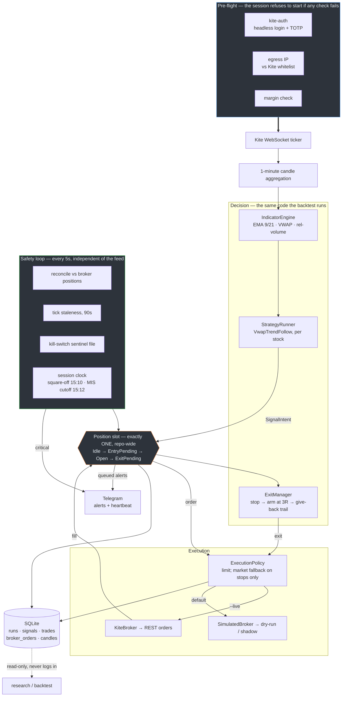

# tradex

Two independent systems for trading Indian equity markets, built around one
goal: find something that returns ~2% a month with evidence behind it rather
than a backtest curve.

| | | |
|---|---|---|
| **[`intraday/`](intraday/)** | Rust | NSE intraday equity. A live short book trading real money through Kite Connect, plus the research that produced it. |
| **[`tradex/`](tradex/)** + [`scripts/`](scripts/) | Python | NSE F&O EOD data pipeline — index options and futures bhavcopy, for backtesting monthly iron condors. |

They share no code and no database. Everything below the architecture section
is about `intraday/`; the EOD pipeline is documented
[further down](#eod-options-data-pipeline).

---

## Live trading architecture



Three decisions carry most of the design, and
[docs/architecture.md](intraday/docs/architecture.md) explains all of them:

* **One position slot for the whole book.** A second stock signalling while the
  slot is busy is logged and dropped, never queued. The slot is the scarce
  resource the strategy is optimised around, which is why the objective is
  Avg R *per trade taken*, not win rate.
* **The safety loop does not depend on market data.** Reconciliation, staleness
  detection and the kill switch run on their own 5-second tick, because a quiet
  feed used to mean none of them ran at all.
* **Entries never chase; stops always fill.** An entry limit that does not fill
  in 60s is abandoned. A stop-loss limit that does not fill escalates to a
  market order — a resting limit does not protect against a gap, it just sits
  there while the loss grows.

---

## Strategy

**[Full write-up → `intraday/docs/strategies.md`](intraday/docs/strategies.md)**

Short-only intraday mean-reversion-against-trend. A stock that rolls over
mid-morning — EMA 9 crossing below EMA 21, price below a VWAP that has itself
turned down, on above-average volume — tends to keep sliding for an hour or
two.

| | |
|---|---|
| Entry window | 10:30–11:30 IST |
| Entry | EMA 9/21 cross down · close < VWAP · VWAP flat-or-down over 20 bars · rel-volume ≥ 1.2x · opening-range break agrees |
| Stop | 0.75% (**this defines 1 R**) |
| Arming | at 3 R in favour (2.25%), the stop jumps to that level |
| Trail | 0.75% give-back from the peak |
| Square-off | 15:10 IST, unconditional |
| Book | 25 stocks, re-ranked quarterly on trailing Avg R |
| Sizing | ₹1,00,000 margin, ~₹5,00,000 notional at MIS leverage, one position |
| Breakeven | **0.061 R** (~₹223 round trip, already subtracted below) |

### Backtested results

Unconstrained book, every signal. Strategy run 417 against a random-entry
control (run 263), both at the 15:10 square-off.
[6-month detail](intraday/research/stock-selection/detail-6m-quarterly.md) ·
[24-month detail](intraday/research/stock-selection/detail-24m-quarterly.md)

| selection window | sample | trades | net R | random | entry edge | mean full year |
|---|---|---|---|---|---|---|
| 6 months | 2019Q2–2026Q3 | 8,573 | **+0.0269** | −0.0018 | +0.0287 | ₹+20,584 |
| 24 months *(live)* | 2020Q4–2026Q3 | 6,621 | **+0.0133** | +0.0009 | +0.0124 | ₹+4,813 |

`entry edge` is the strategy minus a coin-flip entry **on the same basket**,
managed by the same stop, trail and square-off. Every result in this repo
carries one, because "the strategy made +0.03 R" does not say whether the
signal or the stock-picking did the work.

Restricted to **2021Q1 onward**, which drops one exceptional post-COVID quarter
that exists in the 24-month series only because that is the first quarter a
24-month window can trade:

| window | net R | random | entry edge |
|---|---|---|---|
| 6 months | +0.0148 *(0.85 SE)* | −0.0087 | +0.0235 |
| 24 months *(live)* | **+0.0002** | −0.0003 | +0.0006 |

Two things these numbers are not:

* **They are gross of market impact.** A square-root estimate puts it near
  0.06 R round trip at median size — the same order as the edge.
* **They assume a 97.9% fill rate.** Classifying 8,333 entry signals by what
  the next bar's open did to our limit: 21.5% fill *better* than modelled,
  9.9% fill as modelled, 2.1% never touch, and **66.5% open exactly at our
  price** and are queue-dependent. The true rate is somewhere between 31.5%
  and 97.9%, and live experience so far is at the bad end — one timing miss,
  and one order for 153% of that minute's entire traded volume.

### The correction worth reading first

Zerodha refuses MIS orders from **15:12**, so the 15:15 square-off that every
number in this repo assumed before 2026-09-30 was never executable. On the
live book, moving to 15:10 cost **−0.0426 R/trade — 76% of the measured edge**
(t = −3.91, 19 of 24 quarters worse). The selected book is hurt 2.3x more than
the average stock, because ranking on trailing Avg R preferentially picks
stocks that make their money in the final five minutes.
[Full working →](intraday/research/stock-selection/square-off-1515-vs-1510.md)

Numbers for every other strategy tested — long side, 10 swing setups,
volume-spike scalping, 14 entry filters, per-stock tuning — are in
[docs/strategies.md](intraday/docs/strategies.md#other-strategies-tested).
How a result earns belief here is in
[docs/research-method.md](intraday/docs/research-method.md).

---

## Telegram alerts

The live engine never sends anything itself — it queues typed alerts and the
CLI drains them, so a failure in the alerting path cannot affect a trading
decision. [Setup and details →](intraday/docs/operations.md#telegram-alerting)

```toml
# intraday/config/alerts.toml   (gitignored)
[channel]
kind = "telegram"              # or "ntfy" / "webhook"
bot_token = "123456:ABC-DEF..."
chat_id = "-987654321"         # negative for a group

heartbeat_url = "https://hc-ping.com/YOUR-CHECK-UUID"
```

```sh
./scripts/setup_telegram_alerts.sh    # walks through BotFather → chat id
papertrader test-alert                # confirm delivery
```

| alert | fires when | critical |
|---|---|---|
| `Entry` / `Exit` | a position opened or closed, with price, stop, target, realised R | no |
| `EntryUnfilled` | an entry limit timed out after 60s | no |
| `OrderRejected` | the broker refused an order, with its reason | **yes** |
| `ExitEscalated` | a stop-loss limit became a market order | **yes** |
| `Halted` | kill switch engaged, or reconciliation found a mismatch | **yes** |
| `Critical` | anything that could leave a position unaccounted for | **yes** |

Plus a heartbeat at session start, through the day, and at close with a tally.

`[channel]` and `heartbeat_url` are two independent halves and a live session
wants both: the channel is the process reporting what it noticed, so it dies
with the process. `heartbeat_url` is a dead-man's switch — the *absence* of
pings raises the alarm, from a service running elsewhere. That is the half
that survives a crash, the machine sleeping, or a power cut.

Messages split at 3,900 characters with 1.1s pacing between parts (Telegram
throttles a burst and will silently drop one), and URLs are stripped from
error messages before logging so a failed request cannot put the bot token in
a log file.

---

## Intraday: getting started

```sh
cd intraday

cp secrets/credentials.example.toml secrets/credentials.toml   # Kite API creds
cp config/ip_whitelist.example.toml config/ip_whitelist.toml   # live only
cp config/alerts.example.toml config/alerts.toml
chmod 600 secrets/credentials.toml config/alerts.toml

cargo build --release
cargo test                      # 240 tests, no network or DB needed

papertrader collect                                     # minute-candle collector
papertrader live-trade check                            # read-only pre-flight
papertrader shadow --config config/tune30_live.toml     # simulated fills
papertrader live-trade run --live --config config/tune30_live.toml
papertrader live-trade halt                             # stop new entries
```

`--live` is never a default, and the engine refuses to start when this
machine's egress IP is not in `config/ip_whitelist.toml`.

**Do not run anything that touches Kite while a live session is up.**
`backfill`, `market quote` and `live-trade check` each mint a fresh access
token, invalidating the one the live process holds; logging into Kite Web does
the same. `papertrader research` is safe — it reads through a cache-only feed
that cannot make a network call.

Daily operations, the watchdog and logging:
[docs/operations.md](intraday/docs/operations.md).

### Layout

```
intraday/
  crates/            14 library crates, ports-and-adapters
    core-types/      the traits: Broker, MarketDataFeed, Strategy,
                     ExitManager, Storage, TradingCalendar, LoginProvider
    kite-auth/       headless login + TOTP
    kite-client/     REST + WebSocket, IPv4-bound
    strategies/      strategy implementations, incl. the random-entry control
    risk/            stop → arm → trail state machine
    live-trading/    LiveEngine, ExecutionPolicy, session clock, IP check
    backtest/        backtest driver + CacheOnlyFeed
  cli/               the `papertrader` binary
  config/            default.toml, tune30_live.toml (the live book)
  docs/              strategies, architecture, research method, operations
  research/          every run's output, kept for audit
  web/               local read-only dashboard
```

---

## EOD options data pipeline

Downloads the daily **NSE F&O bhavcopy** — every contract's OHLC, settlement
price, open interest and volume — and normalizes it into per-underlying Parquet
tables a backtester can read directly, plus index spot OHLC.

NSE changed the bhavcopy format on **2024-07-05** (legacy zipped CSV → UDiFF).
`jugaad-data` only knows the old URL, so this repo has its own downloader
([tradex/fo_bhavcopy.py](tradex/fo_bhavcopy.py)) that handles **both** and maps
them to one schema.

```sh
python3 -m venv .venv && .venv/bin/pip install -r requirements.txt

.venv/bin/python scripts/backfill_fo.py        # full backfill, ~60-90 min, resumable
.venv/bin/python scripts/backfill_index.py
.venv/bin/python -m tradex.consolidate         # build the consolidated tables

.venv/bin/python scripts/backfill_fo.py --from 2026-08-01   # daily top-up
```

`backfill_fo.py` is **idempotent**: a day already saved is skipped, and
holidays are remembered in `data/raw/fo/_no_data_dates.json` so re-runs don't
re-hit NSE. Transient failures just need the same command again.

### Schema (`data/processed/*.parquet`)

| column | meaning |
|---|---|
| `date` | trading day |
| `symbol` | `NIFTY` / `BANKNIFTY` |
| `instrument` | `OPTIDX` / `FUTIDX` |
| `expiry` | contract expiry date |
| `strike` | strike (null for futures) |
| `option_type` | `CE` / `PE` (`""` for futures) |
| `open/high/low/close` | traded prices (0 if the contract didn't trade) |
| `settle` | settlement price — use this, not `close`, for illiquid strikes |
| `oi` / `change_in_oi` | open interest |
| `contracts` | volume (contracts traded) |
| `value_cr` | turnover, ₹ crore |
| `underlying` | spot at EOD (UDiFF era only; null pre-2024-07) |

### Limitations

* **EOD only.** NSE gives no free historical intraday; minute bars come from
  Kite Connect historical instead (which is what `intraday/` uses).
* `close` is 0 for contracts that didn't trade; `settle` is always populated. A
  backtest must prefer `settle` for far-OTM strikes.
* No bid/ask or greeks — model them from `settle` + spot + a rate assumption.
* Pre-2024-07 rows have no `underlying`; join `data/index/*.csv` for spot.

---

## Not in this repository

`.gitignore` excludes, deliberately: Kite API credentials
(`intraday/secrets/`), the Telegram bot token and ntfy topic
(`intraday/config/alerts.toml`), the egress IP mirrored from the Kite console
(`intraday/config/ip_whitelist.toml`), every `*.bak*` copy of those, the
~33 GB minute-candle cache and trade database (`intraday/data/`), and the
downloaded F&O data (`data/`). Example templates are committed for each
config file.

## Disclaimer

Research code for personal use, published as a record of method. It is not
investment advice and not a recommendation to trade any of this. The live
strategy's own numbers say it is unproven: ~0 net of costs since 2021, gross of
market impact, on a fill rate it has not achieved live.
