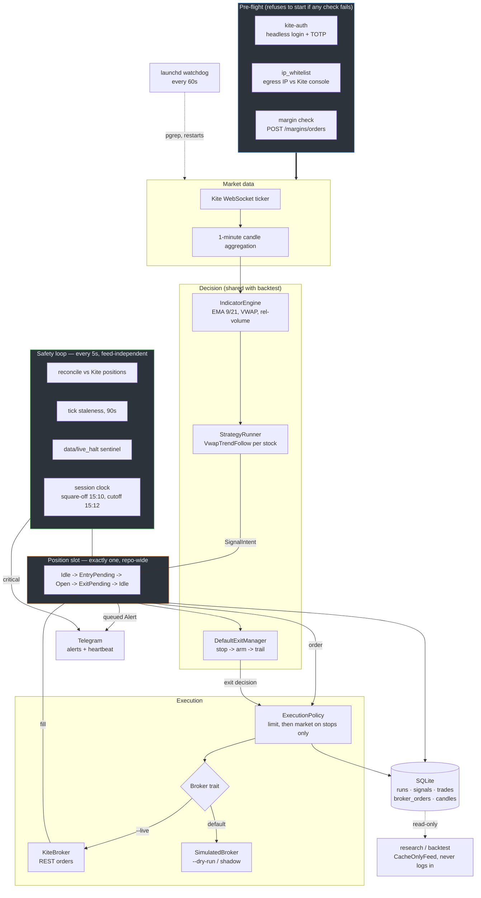
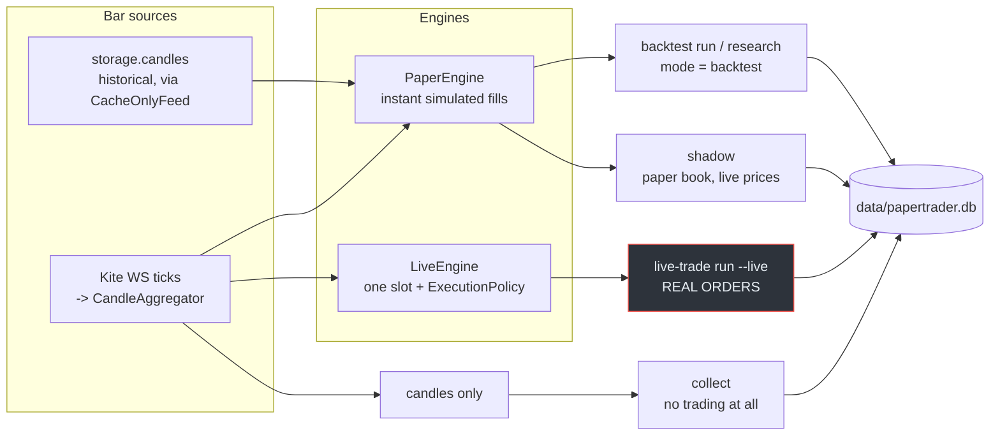

# Architecture

A Rust workspace in ports-and-adapters style — 14 library crates plus the
`cli` and `web` binaries, 16 members in all. Every external
dependency — broker, market data, storage, calendar, login — is a trait in
[`core-types`](../crates/core-types/src/traits.rs) with a real adapter and a
simulated one. That is what lets the same strategy and risk code run under
backtest, paper and live without forking.

## The live session

### Why the shapes are what they are

**One position slot, repo-wide.** `Slot` is a four-state machine
(`Idle → EntryPending → Open → ExitPending → Idle`), not a map of positions.
When a second stock signals while the slot is busy it is logged as
"skipped — slot busy", never queued. The slot is the scarce resource the whole
strategy is optimised around.

**The safety loop does not depend on the feed.** The run loop originally only
ticked on tick arrival, which meant reconciliation and the kill switch never
ran on a quiet feed. There is now a 5-second housekeeping tick independent of
market data, plus a 90-second tick-staleness watchdog.

**Entries never chase; stops always fill.** `ExecutionPolicy` implements two
policies deliberately: entries and target exits are a plain limit with no
fallback (a missed entry is a missed trade), while a **stop-loss** exit escalates
to a market order if the limit has not filled — a resting limit does not protect
against a gap, it just sits there while the loss grows.

**Nothing of ours is scheduled at or after the broker cutoff.** Zerodha refuses
MIS orders from 15:12, so [`session.rs`](../crates/live-trading/src/session.rs)
puts square-off at **15:10** with a 2-minute drain, and its tests assert that no
scheduled action lands at or after the cutoff.

**Research cannot kill the live session.** A Kite login rotates the access token
the live process is holding, so backtests read through
[`CacheOnlyFeed`](../crates/backtest/src/cache_only_feed.rs), which refuses all
network calls by construction.

## Run modes

Four ways to run, all writing into one SQLite file. The thing worth
understanding is which of them share a code path.

| command | bars | engine | writes |
|---|---|---|---|
| `backtest run`, `research` | historical candles, interleaved across instruments in true time order | `PaperEngine` | `signals`, `trades` (mode `backtest`) |
| `shadow` | live ticks | `PaperEngine` | `signals`, `trades` — the unconstrained book, run daily alongside live for comparison |
| `live-trade run --live` | live ticks | **`LiveEngine`** | `signals`, `trades`, `broker_orders` (mode `live`) |
| `collect` | live ticks | none | `candles` only — ~253 instruments (NSE 250 + INDIA VIX + near-month index futures), independent of what is being traded |

`collect` is deliberately separate from trading so the research dataset keeps
growing regardless of today's book. `shadow` exists so the full book's
behaviour is recorded even though the live engine can only hold one position —
the backtest numbers are all unconstrained-book numbers, and this is what
keeps them checkable against reality.

Note that live trading does **not** share `PaperEngine` with the backtest.
`LiveEngine` reuses the same `StrategyRunner` and `ExitManager`, but replaces
instant fills with `ExecutionPolicy` and the position map with the single-slot
state machine. That divergence is deliberate, and it is also where the
indicator-freeze gap below comes from.

## Crates

| crate | role |
|---|---|
| `core-types` | Traits (`Broker`, `MarketDataFeed`, `Strategy`, `ExitManager`, `Storage`, `TradingCalendar`, `LoginProvider`) and the shared domain types |
| `kite-auth` | Headless Kite login with TOTP; mints and caches the daily access token |
| `kite-client` | REST + WebSocket client. IPv4-bound, with one auth-failure retry routed through every verb |
| `market-calendar` | NSE trading calendar and holiday overrides |
| `indicators` | EMA, VWAP, relative volume, opening range |
| `strategy-core` | `IndicatorEngine` and `StrategyRunner` — bar plumbing shared by every strategy |
| `strategies` | The strategy implementations, including `RandomEntry` |
| `risk` | `DefaultExitManager`: hard stop, arming at the reward multiple, give-back trail |
| `storage` | SQLite schema and queries |
| `paper-engine` | Simulated fills for backtest and shadow |
| `backtest` | Backtest driver and `CacheOnlyFeed` |
| `live-trading` | `LiveEngine`, `ExecutionPolicy`, `SimulatedBroker`, session clock, IP check, alerts |
| `universe` | Instrument list and screening |
| `scheduler` | Session scheduling |
| `cli` | `papertrader` binary — every command |
| `web` | Local read-only dashboard |

## Database

One SQLite file, `data/papertrader.db`. The tables that matter:

| table | holds |
|---|---|
| `runs` | One row per backtest/live run, with `config_snapshot_json` |
| `candles` | 1-minute OHLCV cache, the backtest's data source |
| `signals` | Every signal, including ones not traded, with `params_json` |
| `trades` | Entry/exit, `r_multiple`, exit reason |
| `trade_stop_events` | Each stop movement within a trade |
| `broker_orders` | Every place/modify/cancel/status poll, with the raw broker response |
| `instruments` | Token to tradingsymbol mapping |

`broker_orders` exists so that every order action is auditable after the fact,
including rejections and the market-order escalations.

## Known gaps

Listed in full under [open problems](strategies.md#open-problems). The two
that are architectural rather than statistical:

* **Indicators freeze while a position is open.** `runner.on_bar` is only
  reached from `try_enter`, so in `LiveEngine` no stock's indicators advance
  while the slot is occupied. The backtest only freezes the held stock, so the
  two diverge.
* **The watchdog checks liveness, not productivity.** `pgrep` passes for a
  collector that is alive but has stopped writing candles, which has happened
  twice.
